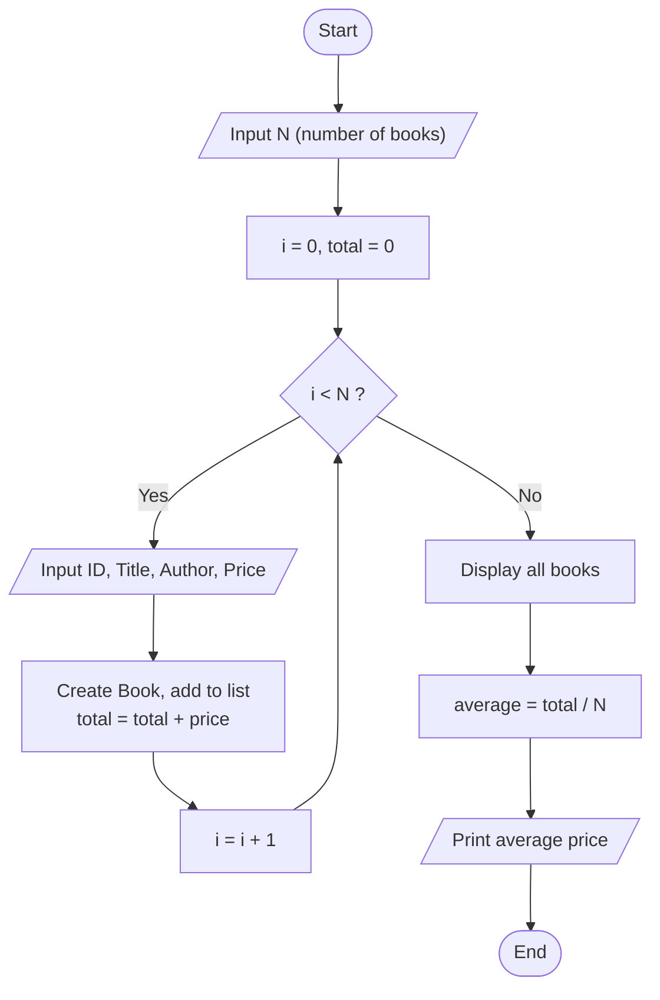
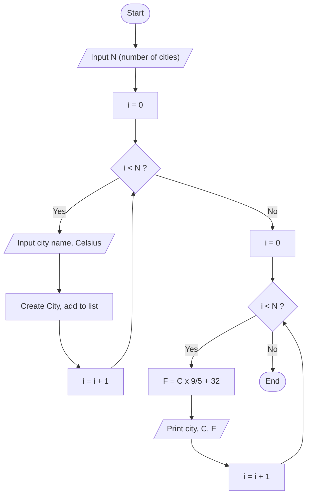
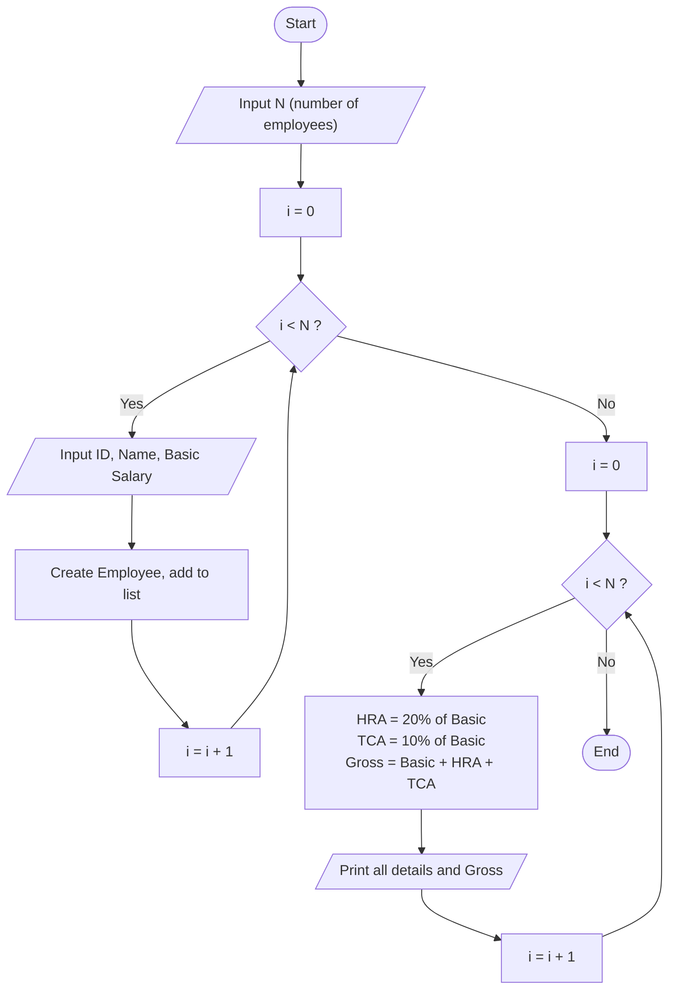
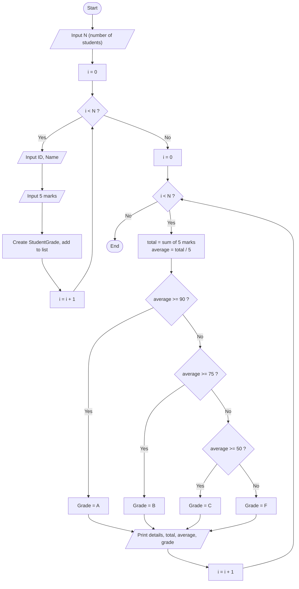
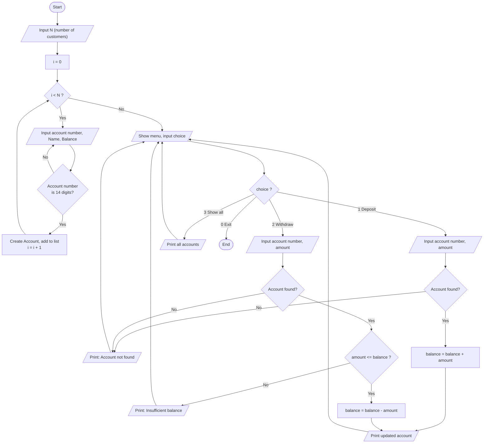

# Lab 3: Code and Flowcharts

Flowcharts are written in Mermaid. They show as diagrams in GitHub, VS Code preview, and most Markdown viewers.

## Practice 1: Library Management System

### Flowchart



### Code

**Book.java**

```java
package lab3;

public class Book {
    private int id;
    private String title;
    private String author;
    private double price;

    public Book() {
        this.id = 0;
        this.title = "Unknown";
        this.author = "Unknown";
        this.price = 0;
    }

    public Book(int id, String title, String author, double price) {
        this.id = id;
        this.title = title;
        this.author = author;
        this.price = price;
    }

    public double getPrice() {
        return price;
    }

    public void print() {
        System.out.println("ID: " + id + " | Title: " + title + " | Author: " + author + " | Price: $" + price);
    }
}
```

**BookTest.java**

```java
package lab3;

import java.util.Scanner;
import java.util.ArrayList;
import java.util.List;

public class BookTest {
    public static void main(String[] args) {
        Scanner sc = new Scanner(System.in);

        System.out.print("Enter number of books: ");
        int n = Integer.parseInt(sc.nextLine());

        List<Book> books = new ArrayList<Book>();
        double total = 0;

        for (int i = 0; i < n; i++) {
            System.out.println("Book " + (i + 1));
            System.out.print("  Book ID: ");
            int id = Integer.parseInt(sc.nextLine());
            System.out.print("  Title: ");
            String title = sc.nextLine();
            System.out.print("  Author: ");
            String author = sc.nextLine();
            System.out.print("  Price: ");
            double price = Double.parseDouble(sc.nextLine());

            Book b = new Book(id, title, author, price);
            books.add(b);
            total += b.getPrice();
        }

        System.out.println("\n--- All Books ---");
        for (Book b : books) {
            b.print();
        }
        System.out.println("Average price: $" + (total / books.size()));

        sc.close();
    }
}
```

## Practice 2: Temperature Conversion

### Flowchart



### Code

**City.java**

```java
package lab3;

public class City {
    private String name;
    private double celsius;

    public City() {
        this.name = "Unknown";
        this.celsius = 0;
    }

    public City(String name, double celsius) {
        this.name = name;
        this.celsius = celsius;
    }

    public double toFahrenheit() {
        return (celsius * 9 / 5) + 32;
    }

    public void print() {
        System.out.println(name + ": " + celsius + " C = " + toFahrenheit() + " F");
    }
}
```

**CityTest.java**

```java
package lab3;

import java.util.Scanner;
import java.util.ArrayList;
import java.util.List;

public class CityTest {
    public static void main(String[] args) {
        Scanner sc = new Scanner(System.in);

        System.out.print("Enter number of cities: ");
        int n = Integer.parseInt(sc.nextLine());

        List<City> cities = new ArrayList<City>();

        for (int i = 0; i < n; i++) {
            System.out.print("City " + (i + 1) + " name: ");
            String name = sc.nextLine();
            System.out.print("Temperature in Celsius: ");
            double c = Double.parseDouble(sc.nextLine());
            cities.add(new City(name, c));
        }

        System.out.println("\n--- Temperatures ---");
        for (City c : cities) {
            c.print();
        }

        sc.close();
    }
}
```

## Practice 3: Employee Salary Management

### Flowchart



### Code

**Employee.java**

```java
package lab3;

public class Employee {
    private int id;
    private String name;
    private double basicSalary;

    public Employee() {
        this.id = 0;
        this.name = "Unknown";
        this.basicSalary = 0;
    }

    public Employee(int id, String name, double basicSalary) {
        this.id = id;
        this.name = name;
        this.basicSalary = basicSalary;
    }

    public double getHRA() {
        return basicSalary * 0.20;
    }

    public double getTCA() {
        return basicSalary * 0.10;
    }

    public double getGrossSalary() {
        return basicSalary + getHRA() + getTCA();
    }

    public void print() {
        System.out.println("ID: " + id + " | Name: " + name + " | Basic: " + basicSalary
                + " | HRA: " + getHRA() + " | TCA: " + getTCA() + " | Gross: " + getGrossSalary());
    }
}
```

**EmployeeTest.java**

```java
package lab3;

import java.util.Scanner;
import java.util.ArrayList;
import java.util.List;

public class EmployeeTest {
    public static void main(String[] args) {
        Scanner sc = new Scanner(System.in);

        System.out.print("Enter number of employees: ");
        int n = Integer.parseInt(sc.nextLine());

        List<Employee> employees = new ArrayList<Employee>();

        for (int i = 0; i < n; i++) {
            System.out.println("Employee " + (i + 1));
            System.out.print("  Employee ID: ");
            int id = Integer.parseInt(sc.nextLine());
            System.out.print("  Name: ");
            String name = sc.nextLine();
            System.out.print("  Basic salary: ");
            double basic = Double.parseDouble(sc.nextLine());
            employees.add(new Employee(id, name, basic));
        }

        System.out.println("\n--- Salary Details ---");
        for (Employee e : employees) {
            e.print();
        }

        sc.close();
    }
}
```

## Practice 4: Student Grades Calculation

### Flowchart



### Code

**StudentGrade.java**

```java
package lab3;

public class StudentGrade {
    private int id;
    private String name;
    private double[] marks;

    public StudentGrade() {
        this.id = 0;
        this.name = "Unknown";
        this.marks = new double[5];
    }

    public StudentGrade(int id, String name, double[] marks) {
        this.id = id;
        this.name = name;
        this.marks = marks;
    }

    public double getTotal() {
        double total = 0;
        for (double m : marks) {
            total += m;
        }
        return total;
    }

    public double getAverage() {
        return getTotal() / 5;
    }

    public char getGrade() {
        double avg = getAverage();
        if (avg >= 90) {
            return 'A';
        } else if (avg >= 75) {
            return 'B';
        } else if (avg >= 50) {
            return 'C';
        } else {
            return 'F';
        }
    }

    public void print() {
        System.out.println("ID: " + id + " | Name: " + name + " | Total: " + getTotal()
                + " | Average: " + getAverage() + " | Grade: " + getGrade());
    }
}
```

**StudentGradeTest.java**

```java
package lab3;

import java.util.Scanner;
import java.util.ArrayList;
import java.util.List;

public class StudentGradeTest {
    public static void main(String[] args) {
        Scanner sc = new Scanner(System.in);

        System.out.print("Enter number of students: ");
        int n = Integer.parseInt(sc.nextLine());

        List<StudentGrade> students = new ArrayList<StudentGrade>();

        for (int i = 0; i < n; i++) {
            System.out.println("Student " + (i + 1));
            System.out.print("  Student ID: ");
            int id = Integer.parseInt(sc.nextLine());
            System.out.print("  Name: ");
            String name = sc.nextLine();

            double[] marks = new double[5];
            for (int j = 0; j < 5; j++) {
                System.out.print("  Mark " + (j + 1) + ": ");
                marks[j] = Double.parseDouble(sc.nextLine());
            }
            students.add(new StudentGrade(id, name, marks));
        }

        System.out.println("\n--- Student Results ---");
        for (StudentGrade s : students) {
            s.print();
        }

        sc.close();
    }
}
```

## Practice 5: Simple Banking System

### Flowchart



### Code

**Account.java**

```java
package lab3;

public class Account {
    private String accountNumber;
    private String name;
    private double balance;

    public Account() {
        this.accountNumber = "00000000000000";
        this.name = "Unknown";
        this.balance = 0;
    }

    public Account(String accountNumber, String name, double balance) {
        this.accountNumber = accountNumber;
        this.name = name;
        this.balance = balance;
    }

    public String getAccountNumber() {
        return accountNumber;
    }

    public void deposit(double amount) {
        if (amount > 0) {
            balance += amount;
            System.out.println("Deposit successful.");
        } else {
            System.out.println("Amount must be positive.");
        }
    }

    public void withdraw(double amount) {
        if (amount <= 0) {
            System.out.println("Amount must be positive.");
        } else if (amount > balance) {
            System.out.println("Insufficient balance.");
        } else {
            balance -= amount;
            System.out.println("Withdraw successful.");
        }
    }

    public void print() {
        System.out.println("Account: " + accountNumber + " | Name: " + name + " | Balance: $" + balance);
    }
}
```

**AccountTest.java**

```java
package lab3;

import java.util.Scanner;
import java.util.ArrayList;
import java.util.List;

public class AccountTest {
    public static void main(String[] args) {
        Scanner sc = new Scanner(System.in);

        System.out.print("Enter number of customers: ");
        int n = Integer.parseInt(sc.nextLine());

        List<Account> accounts = new ArrayList<Account>();

        for (int i = 0; i < n; i++) {
            System.out.println("Customer " + (i + 1));
            String number;
            do {
                System.out.print("  Account number (14 digits): ");
                number = sc.nextLine();
            } while (number.length() != 14);
            System.out.print("  Name: ");
            String name = sc.nextLine();
            System.out.print("  Balance: ");
            double balance = Double.parseDouble(sc.nextLine());
            accounts.add(new Account(number, name, balance));
        }

        int choice;
        do {
            System.out.println("\n1. Deposit  2. Withdraw  3. Show all  0. Exit");
            System.out.print("Choice: ");
            choice = Integer.parseInt(sc.nextLine());

            if (choice == 1 || choice == 2) {
                System.out.print("Account number: ");
                String number = sc.nextLine();

                Account found = null;
                for (Account a : accounts) {
                    if (a.getAccountNumber().equals(number)) {
                        found = a;
                    }
                }

                if (found == null) {
                    System.out.println("Account not found.");
                } else {
                    System.out.print("Amount: ");
                    double amount = Double.parseDouble(sc.nextLine());
                    if (choice == 1) {
                        found.deposit(amount);
                    } else {
                        found.withdraw(amount);
                    }
                    found.print();
                }
            } else if (choice == 3) {
                for (Account a : accounts) {
                    a.print();
                }
            }
        } while (choice != 0);

        sc.close();
    }
}
```

